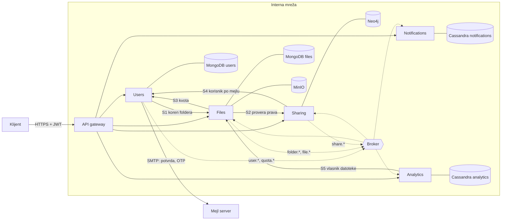
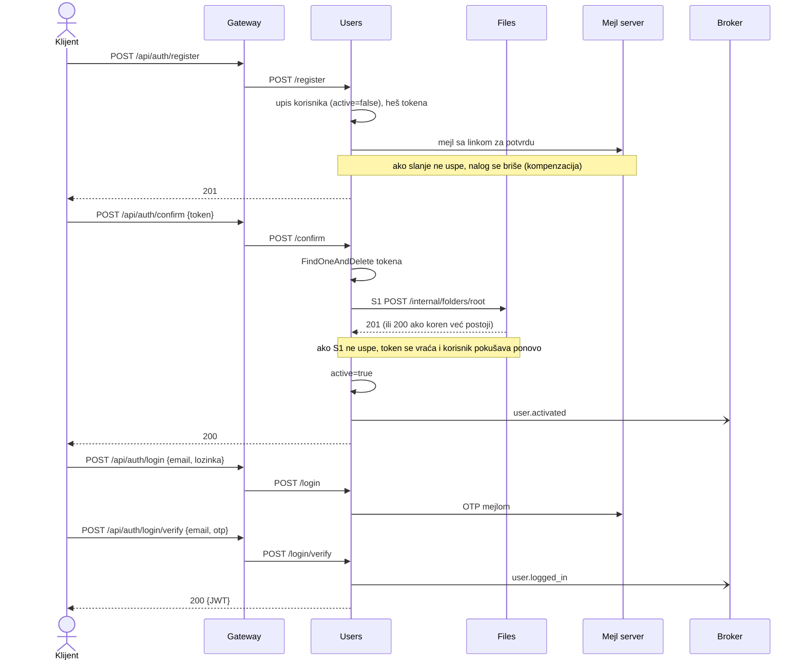
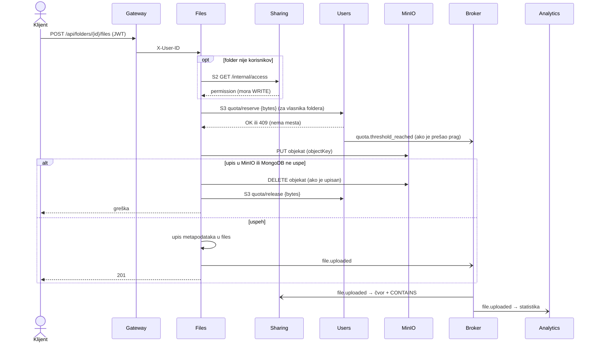
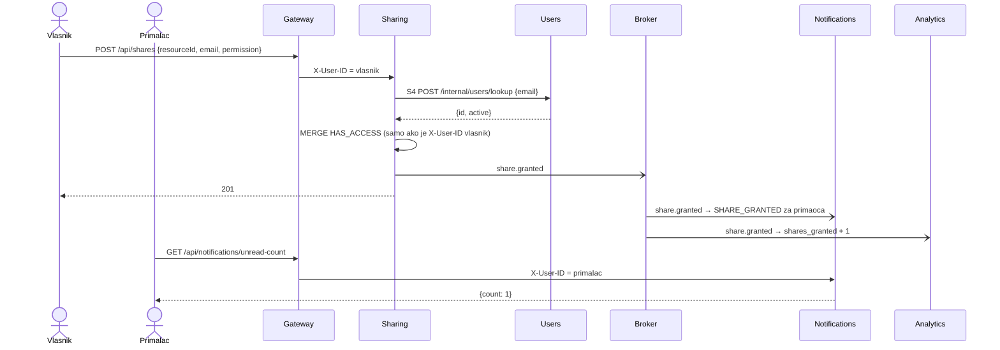

# Dizajn sistema

Dokument opisuje arhitekturu mikroservisne platforme za skladištenje i
deljenje datoteka (US-29): šta svaki servis čuva, u kojoj bazi i zašto, i kako
servisi komuniciraju. Služi kao zajednička referenca tima pri implementaciji
story-ja; kada se story implementira drugačije nego što piše ovde, dokument se
menja u istom PR-u.

### Arhitektura ukratko

Klijent komunicira samo sa **API gateway-em**, koji proverava JWT i
prosleđuje zahtev jednom od pet servisa. Svaki servis ima svoju bazu, izabranu
prema obliku podataka i upitima, i nijedan servis ne čita tuđu bazu. Servisi
se međusobno pozivaju sinhrono (HTTP, uvek sa timeoutom) samo kada im odgovor
treba odmah, a sve ostalo javljaju događajima preko brokera.

| Servis | Odgovornost | Skladište | Zašto ta baza | Vlasnik |
|---|---|---|---|---|
| API gateway | Jedina ulazna tačka, provera JWT-a, rutiranje | — | — | AP |
| Users | Registracija, prijava (lozinka + OTP), uloge, kvota | MongoDB | Nalozi kao dokumenti, jedinstven mejl, TTL indeksi za tokene i OTP | SC |
| Files | Folderi, metapodaci datoteka, sadržaj, pretraga | MongoDB + MinIO | Stablo foldera i metapodaci kao dokumenti; sadržaj u object store-u | SB |
| Sharing | Ko ima pristup čemu, nasleđivanje prava kroz foldere | Neo4j | Pravo nad folderom važi za ceo podgraf: upit po putanji | AP |
| Notifications | Obaveštenja u aplikaciji | Cassandra | Mnogo upisa, čitanje po korisniku i vremenu | AP |
| Analytics | Aktivnost i statistika iz događaja | Cassandra | Vremenska serija koja se samo dopunjuje, brojači po danu | AP |

### Sadržaj

1. [Model podataka – Users i Files](#1-model-podataka--users-i-files)
2. [Model podataka – Sharing (Neo4j)](#2-model-podataka--sharing-neo4j)
3. [Model podataka – Notifications (Cassandra)](#3-model-podataka--notifications-cassandra)
4. [Model podataka – Analytics (Cassandra) i događaji](#4-model-podataka--analytics-cassandra-i-događaji)
5. [Mapa komunikacije](#5-mapa-komunikacije)
6. [Otvorene odluke](#6-otvorene-odluke)

### Oznake

- *Planirano*: deo dizajna koji još ne postoji u kodu (polje se ne koristi,
  ruta ili poziv nisu napravljeni).
- *Pretpostavka*: izvedeno iz opisa platforme, a ne iz kriterijuma
  prihvatanja; potvrđuje se kada se story implementira.
- *Predlog*: preporuka vlasniku servisa koju tek treba prihvatiti ili odbiti.

Sve tri vrste su sakupljene u [sekciji 6](#6-otvorene-odluke), sa vlasnikom
odluke.

---

## 1. Model podataka – Users i Files

Oba servisa koriste **MongoDB** (dokument-orijentisana baza), svaki svoju bazu
(`USERS_MONGO_DB=users`, `FILES_MONGO_DB=files`). Servisi ne čitaju tuđu bazu;
podaci drugog servisa dobijaju se samo preko njegovog API-ja. Sadržaj datoteka
nije u MongoDB-u nego u object store-u (**MinIO**, bucket `MINIO_BUCKET`).

Oznake u tabelama:
- **Obavezno**: polje uvek postoji i ima smislenu vrednost.
- **Ka klijentu**: da li se polje serijalizuje u JSON odgovor (`json:"-"` = ne).

### 1.1 Pregled

```
 Users servis (baza: users)                 Files servis (baza: files)
 ┌──────────────────────┐                   ┌──────────────────────┐
 │ users                │  _id = ownerId    │ folders              │◄─┐ parentId
 │  _id, email, role,   │──────────────────►│  _id, ownerId,       │──┘ (stablo)
 │  quotaBytes,         │   (logička veza,  │  parentId, name      │
 │  usedBytes, ...      │    bez FK)        └──────────▲───────────┘
 └───┬──────────────┬───┘                              │ parentId
     │ userId       │ _id = userId        ┌────────────┴─────────┐
 ┌───▼──────────┐ ┌─▼──────────┐          │ files (metapodaci)   │
 │ confirmation │ │ otps       │          │  _id, ownerId,       │
 │ _tokens (TTL)│ │ (TTL)      │          │  parentId, size,     │
 └──────────────┘ └────────────┘          │  objectKey ──────────┼──► MinIO objekat
                                          └──────────────────────┘    (sadržaj)
```

### 1.2 Users servis

#### Kolekcija `users`

Model: `services/users/internal/model/user.go` (`model.User`).

| Polje (BSON) | Go tip | BSON tip | Obavezno | Ka klijentu | Opis |
|---|---|---|---|---|---|
| `_id` | `string` | string | da | da (`id`) | 32 heks znaka (16 nasumičnih bajtova iz `crypto/rand`). Nije sekvencijalan, pa se ne može pogađati. |
| `firstName` | `string` | string | da | da | Ime. |
| `lastName` | `string` | string | da | da | Prezime. |
| `email` | `string` | string | da | da | Čuva se normalizovan (`trim` + mala slova), pa je jedinstvenost praktično neosetljiva na velika/mala slova. |
| `passwordHash` | `string` | string | da | **ne** | Argon2id u PHC formatu (`$argon2id$v=19$m=...,t=...,p=...$salt$hash`); parametri iz env-a. Vidi `docs/izbor-hesiranja-lozinki.md`. |
| `role` | `model.Role` | string | da | da | `USER` ili `ADMIN`. Registracija uvek daje `USER`; admin nastaje samo pri startu servisa (US-24). |
| `active` | `bool` | bool | da | da | `false` dok korisnik ne potvrdi registraciju mejlom (US-04); admin je odmah aktivan. |
| `quotaBytes` | `int64` | long | da | da | Dozvoljeni prostor u bajtovima; početno `USERS_DEFAULT_QUOTA_BYTES` (1 GiB). |
| `usedBytes` | `int64` | long | da | da | Zauzeti prostor; početno 0. Mora važiti `0 ≤ usedBytes ≤ quotaBytes`. |
| `passwordChangedAt` | `time.Time` | date (UTC) | da | da | Trenutak poslednje promene lozinke; pri registraciji = `createdAt`. *Planirano*: JWT izdat pre ovog trenutka (`iat < passwordChangedAt`) smatra se nevažećim. |
| `createdAt` | `time.Time` | date (UTC) | da | da | Trenutak kreiranja naloga. |

Indeksi:

| Ime | Ključ | Opcije | Upit kome služi |
|---|---|---|---|
| `_id_` | `_id` | podrazumevani | `FindByID`, `Activate`, `Delete` |
| `uniq_email` | `{ email: 1 }` | `unique` | `FindByEmail` (prijava); baza sama odbija dupli mejl, čak i kod istovremenih registracija |

#### Kolekcija `confirmation_tokens`

Model: `services/users/internal/model/confirmation_token.go`. Jednokratni token
iz linka za potvrdu registracije (US-04).

| Polje (BSON) | Go tip | BSON tip | Obavezno | Ka klijentu | Opis |
|---|---|---|---|---|---|
| `_id` | `string` | string | da | ne | SHA-256 heš tokena (heks). Sam token se ne čuva, pa procurela baza ne daje upotrebljive linkove. |
| `userId` | `string` | string | da | ne | `users._id` naloga koji se potvrđuje. |
| `expiresAt` | `time.Time` | date (UTC) | da | ne | Kraj važenja (`CONFIRMATION_TTL`, podrazumevano 24h). |

Indeksi:

| Ime | Ključ | Opcije | Svrha |
|---|---|---|---|
| `_id_` | `_id` | podrazumevani | Potrošnja tokena po hešu jednim `FindOneAndDelete`, pa je token atomično jednokratan |
| `ttl_expiresAt` | `{ expiresAt: 1 }` | `expireAfterSeconds: 0` | MongoDB sam briše istekle tokene |

#### Kolekcija `otps`

Model: `services/users/internal/model/otp.go`. Jednokratni kod za prijavu (US-05).

| Polje (BSON) | Go tip | BSON tip | Obavezno | Ka klijentu | Opis |
|---|---|---|---|---|---|
| `_id` | `string` | string | da | ne | `users._id`. Pošto je to ključ, korisnik ima najviše jedan aktivan OTP; novi zamenjuje stari. |
| `codeHash` | `string` | string | da | ne | HMAC koda (tajna `OTP_HMAC_SECRET`). Sam kod se ne čuva. |
| `expiresAt` | `time.Time` | date (UTC) | da | ne | Kraj važenja (`OTP_TTL`, podrazumevano 5 min). |
| `attempts` | `int` | int | da | ne | Broj neuspelih pokušaja. *Planirano*: posle limita OTP se poništava (zaštita od pogađanja). |

Indeksi:

| Ime | Ključ | Opcije | Svrha |
|---|---|---|---|
| `_id_` | `_id` | podrazumevani | Pronalaženje OTP-a za korisnika |
| `ttl_expiresAt` | `{ expiresAt: 1 }` | `expireAfterSeconds: 0` | Automatsko brisanje isteklih kodova |

> **Napomena o TTL-u:** MongoDB briše istekle dokumente u pozadini otprilike
> jednom u minuti, pa istekao token ili OTP može kratko ostati u bazi. Servis
> zato uvek sam proverava `expiresAt`; TTL indeks služi samo za čišćenje.

### 1.3 Files servis

#### Kolekcija `folders`

Model: `services/files/internal/model/model.go` (`model.Folder`). Folderi čine
stablo po korisniku (US-01).

| Polje (BSON) | Go tip | BSON tip | Obavezno | Ka klijentu | Opis |
|---|---|---|---|---|---|
| `_id` | `string` | string | da | da (`id`) | UUID v4. |
| `name` | `string` | string | da | da | Naziv foldera; jedinstven među folderima istog roditelja. Korenski folder se zove `root`. |
| `ownerId` | `string` | string | da | da | `users._id` vlasnika (veza ka Users servisu, bez FK). |
| `parentId` | `string` | string | da* | da (izostavlja se ako je prazan) | `_id` roditeljskog foldera. *Prazan string samo kod korenskog foldera. |
| `createdAt` | `time.Time` | date (UTC) | da | da | Trenutak kreiranja. |
| `updatedAt` | `time.Time` | date (UTC) | da | da | Poslednja izmena (npr. preimenovanje). |

Indeksi:

| Ime | Ključ | Opcije | Upit kome služi |
|---|---|---|---|
| `_id_` | `_id` | podrazumevani | `FindByID`, `Rename` |
| `ownerId_1_parentId_1_name_1` | `{ ownerId: 1, parentId: 1, name: 1 }` | `unique` | (1) baza odbija dva foldera istog imena u istom roditelju, i pri kreiranju i pri preimenovanju; (2) `ListByParent` (filter `ownerId`+`parentId`, sort po `name`) koristi isti indeks bez dodatnog sortiranja; (3) `FindRoot` (`ownerId`, `parentId: ""`) |

Korenski folder nastaje kada korisnik potvrdi registraciju: Users servis poziva
Files servis, a `CreateRoot` je idempotentan (ponovljen poziv vraća postojeći
koren). Unique indeks sa fiksnim imenom `root` dodatno sprečava dva korena.

#### Kolekcija `files`

Model: `services/files/internal/model/model.go` (`model.File`). Čuvaju se samo
metapodaci; sadržaj je u MinIO-u (US-02, US-12).

| Polje (BSON) | Go tip | BSON tip | Obavezno | Ka klijentu | Opis |
|---|---|---|---|---|---|
| `_id` | `string` | string | da | da (`id`) | UUID v4. |
| `name` | `string` | string | da | da | Naziv datoteke sa ekstenzijom; jedinstven među datotekama istog foldera. |
| `contentType` | `string` | string | da | da | MIME tip (npr. `application/pdf`). |
| `size` | `int64` | long | da | da | Veličina u bajtovima; ulazi u `users.usedBytes`. |
| `ownerId` | `string` | string | da | da | `users._id` vlasnika. |
| `parentId` | `string` | string | da | da | `folders._id` foldera u kom je datoteka (nikad prazan). |
| `objectKey` | `string` | string | da | **ne** | Ključ objekta u MinIO bucketu. Ne ide ka klijentu; preuzimanje uvek ide kroz servis, koji proverava prava. |
| `hash` | `string` | string | da | **ne** | Heš sadržaja (npr. SHA-256) za proveru integriteta posle otpremanja/preuzimanja. *Planirano*. |
| `createdAt` | `time.Time` | date (UTC) | da | da | Trenutak otpremanja. |
| `updatedAt` | `time.Time` | date (UTC) | da | da | Poslednja izmena. |

Indeksi:

| Ime | Ključ | Opcije | Upit kome služi |
|---|---|---|---|
| `_id_` | `_id` | podrazumevani | `FindByID`, `Rename` |
| `ownerId_1_parentId_1_name_1` | `{ ownerId: 1, parentId: 1, name: 1 }` | `unique` | Jedinstveno ime u folderu; `ListByParent` sortiran po imenu; prefiks `ownerId` pokriva i upite „sve datoteke korisnika“ (npr. preračun zauzeća) |

### 1.4 Veze između entiteta

| Veza | Kardinalnost | Gde se čuva | Kako se održava |
|---|---|---|---|
| `users` → `folders` | 1 : N (tačno jedan koren) | `folders.ownerId` | Koren se kreira pri potvrdi registracije (poziv Users → Files sa timeoutom `USERS_REQUEST_TIMEOUT`). |
| `folders` → `folders` | 1 : N (stablo) | `folders.parentId` | Files servis proverava da roditelj postoji i pripada istom vlasniku. |
| `folders` → `files` | 1 : N | `files.parentId` | Isto kao gore. |
| `users` → `files` | 1 : N | `files.ownerId` | Pri otpremanju i brisanju menja se i `users.usedBytes` (vidi ispod). |
| `files` → MinIO objekat | 1 : 1 | `files.objectKey` | Metapodatak bez objekta ili objekat bez metapodatka je greška; redosled upisa i kompenzacija su deo sage. |
| `users` → `confirmation_tokens` | 1 : N (u praksi 1) | `confirmation_tokens.userId` | Token se briše u istom koraku u kom se čita (`FindOneAndDelete`); neiskorišćeni ističu kroz TTL. |
| `users` → `otps` | 1 : 0..1 | `otps._id` | Novi OTP prepisuje stari. |

Pošto su `users` i `files`/`folders` u različitim bazama i servisima, **nema
stranih ključeva ni transakcija preko granice servisa**. Konzistentnost se
održava ovako:

- **Kvota** (`usedBytes`): otpremanje je raspodeljena operacija (rezervacija
  prostora u Users → upis objekta u MinIO → upis metapodataka u Files). Ako neki
  korak padne, prethodni se poništavaju kompenzacijom (saga, `services/files`).
  Tok je prikazan u 5.6, a poziv za kvotu je S3 u 5.4.
- **Brisanje naloga**: brisanje korisnika mora da povuče brisanje njegovih
  foldera, datoteka i MinIO objekata. Users emituje događaj `user.deleted`, a
  Files, Sharing, Notifications i Analytics svaki briše svoje podatke (5.5).
- Svaki poziv drugog servisa ima timeout (`context.WithTimeout`).

### 1.5 Bezbednosne odluke u modelu (IB)

- Lozinke, tokeni za potvrdu i OTP kodovi **nikad se ne čuvaju u čitljivom
  obliku**: lozinka kao Argon2id, token kao SHA-256, OTP kao HMAC.
- Polja `passwordHash`, `objectKey` i `hash` imaju `json:"-"` i ne mogu
  procureti u odgovor; to proverava test `TestPasswordHashNotSerialized`.
- ID-jevi korisnika su nasumični (128 bita), a folderi i datoteke imaju UUID v4,
  pa se tuđi resursi ne mogu nabrojati pogađanjem ID-ja. Files servis ipak
  posle svakog čitanja po ID-ju proverava `ownerId`, a tuđ folder vraća isto
  kao nepostojeći, pa odgovor ne otkriva da resurs postoji. Pristup tuđem
  resursu ide samo preko provere prava u Sharing servisu (S2 u 5.4).
- Uloga se ne može zadati kroz registraciju: DTO nema polje `role`, a
  `model.NewUser` uvek postavlja `USER`.
- Upiti koriste `bson.D` / `bson.M` sa vrednostima kao parametrima, bez spajanja
  stringova sa korisničkim ulazom (zaštita od NoSQL injekcije).

### 1.6 Predlozi (nije implementirano)

Sledeće se ne nalazi u kodu. Ovo su predlozi za vlasnike servisa (SB za Files,
SC za Users); stanje odluke za svaki je u sekciji 6:

| Kolekcija | Predlog | Razlog |
|---|---|---|
| `files` | tekstualni indeks `{ name: "text" }`, ili indeks `{ ownerId: 1, name: 1 }` za pretragu po prefiksu | Pretraga datoteka po nazivu; postojeći indeks počinje sa `parentId` posle `ownerId`, pa ne pomaže pretrazi kroz sve foldere. |
| `files` | unique indeks `{ objectKey: 1 }` | Garantuje da dva zapisa ne pokazuju na isti objekat (brisanje jednog bi uništilo drugi). |
| `folders` | polje `ancestors: [string]` (ID-jevi predaka) + indeks `{ ownerId: 1, ancestors: 1 }` | Brisanje ili premeštanje celog podstabla jednim upitom i provera da se folder ne premešta u sopstvenog potomka. |
| `users` | indeks `{ role: 1, createdAt: -1 }` | Admin pregled korisnika sa filtrom po ulozi i sortiranjem po datumu. |
| `users` | korišćenje `passwordChangedAt` pri validaciji JWT-a | Posle promene lozinke stari tokeni prestaju da važe. |
| `otps` | limit na `attempts` (npr. 5), posle čega se OTP briše | Sprečava pogađanje 6-cifrenog koda u roku važenja. |
| `files` | popunjavanje i provera `hash` | Otkrivanje oštećenog ili podmetnutog sadržaja u object store-u. |

---

> **Napomena za sekcije 2–4:** servisi Sharing, Notifications i Analytics još
> nemaju kod, pa je ovo **projektovani** model, ne opis postojećeg stanja.
> Upiti koje model podržava izvedeni su iz opisa platforme; tamo gde je nešto
> pretpostavka, piše *Pretpostavka*. Kada se story-ji za ove servise
> implementiraju, model se usklađuje sa njihovim kriterijumima prihvatanja.

## 2. Model podataka – Sharing (Neo4j)

Sharing servis čuva **ko ima pristup čemu**. Deljenje je prirodno graf: folder
podeljen sa korisnikom važi i za sve što je u njemu, na bilo kojoj dubini, a to
je u grafu jedan upit po putanji umesto rekurzije kroz kolekcije.

Graf ne kopira metapodatke datoteka: izvor istine za imena, veličine i stablo
foldera je Files servis. Sharing drži samo ID-jeve, vlasnika, ime (zbog liste
„podeljeno sa mnom“) i strukturu stabla, i ažurira ih na osnovu događaja iz
Files servisa (sekcija 4.2).

### 2.1 Čvorovi

| Label | Svojstva | Opis |
|---|---|---|
| `:User` | `id: String` | Korisnik; `id` = `users._id`. Ne čuva se mejl ni ime (nije potrebno za proveru prava). |
| `:Resource:Folder` | `id: String`, `ownerId: String`, `name: String` | Folder; `id` = `folders._id`. |
| `:Resource:File` | `id: String`, `ownerId: String`, `name: String` | Datoteka; `id` = `files._id`. |

Folder i datoteka dele label `:Resource`, pa jedno ograničenje jedinstvenosti i
jedan upit za proveru prava važe za oba tipa.

### 2.2 Veze

| Veza | Svojstva | Opis |
|---|---|---|
| `(:Folder)-[:CONTAINS]->(:Folder)` / `(:Folder)-[:CONTAINS]->(:File)` | — | Stablo foldera, isto kao `parentId` u Files servisu. Svaki resurs osim korena ima tačno jednu ulaznu `CONTAINS` vezu. |
| `(:User)-[:HAS_ACCESS]->(:Resource)` | `permission: String` (`READ` \| `WRITE`), `grantedBy: String` (ID vlasnika), `grantedAt: DateTime` | Vlasnik je podelio resurs sa korisnikom. Najviše jedna veza po paru korisnik–resurs. |

Vlasništvo se ne modeluje vezom nego svojstvom `ownerId`: vlasnik uvek ima sva
prava, pa za njega nije potreban upit kroz graf.

```
 (:User {id:"ana"})                     (:User {id:"marko"})
                                              │
                                              │ HAS_ACCESS {permission:"READ"}
                                              ▼
 (:Folder {id:"root", ownerId:"ana"}) ─CONTAINS─► (:Folder {id:"f1", name:"Fakultet"})
                                                        │
                                                        ├─CONTAINS─► (:File {id:"x", name:"cv.pdf"})
                                                        └─CONTAINS─► (:Folder {id:"f2"}) ─CONTAINS─► (:File {id:"y"})

 Marko može da čita f1, x, f2 i y (nasleđeno preko CONTAINS).
```

### 2.3 Pravila pristupa

- Vlasnik (`ownerId`) ima puno pravo nad svojim resursima.
- Korisnik ima pravo nad resursom ako postoji `HAS_ACCESS` ka tom resursu
  **ili ka bilo kom folderu iznad njega**.
- Ako postoji više takvih veza (npr. `READ` na folderu i `WRITE` na podfolderu),
  važi **najjače** pravo: `WRITE` > `READ`.
- `WRITE` dozvoljava otpremanje, preimenovanje i brisanje unutar podeljenog
  foldera; `READ` samo pregled i preuzimanje. *Pretpostavka*: precizan skup
  operacija po pravu definiše story za deljenje.
- Deliti može samo vlasnik. *Pretpostavka*: korisnik sa `WRITE` ne može dalje
  deliti tuđi resurs.

### 2.4 Ograničenja i indeksi

```cypher
CREATE CONSTRAINT user_id_unique IF NOT EXISTS
FOR (u:User) REQUIRE u.id IS UNIQUE;

CREATE CONSTRAINT resource_id_unique IF NOT EXISTS
FOR (r:Resource) REQUIRE r.id IS UNIQUE;

CREATE INDEX resource_owner IF NOT EXISTS
FOR (r:Resource) ON (r.ownerId);
```

Ograničenja jedinstvenosti automatski prave indeks po `id`, pa svaki upit
počinje brzim pronalaženjem čvora. Indeks po `ownerId` služi za brisanje svih
resursa korisnika kada se nalog obriše. Jedinstvenost `HAS_ACCESS` po paru
obezbeđuje se tako što se veza uvek pravi sa `MERGE`, nikad sa `CREATE`.

### 2.5 Upiti

Svi upiti koriste parametre (`$userId`, ...), nikad spajanje stringova
(zaštita od Cypher injekcije).

**Podeli resurs** (ili promeni pravo postojećem deljenju):
```cypher
MATCH (r:Resource {id: $resourceId, ownerId: $ownerId})
MERGE (u:User {id: $granteeId})
MERGE (u)-[a:HAS_ACCESS]->(r)
SET a.permission = $permission, a.grantedBy = $ownerId, a.grantedAt = datetime()
```
Filter `ownerId: $ownerId` znači da korisnik ne može da deli tuđ resurs: ako nije
vlasnik, `MATCH` ne nađe ništa i ništa se ne upisuje.

**Ukini deljenje:**
```cypher
MATCH (:User {id: $granteeId})-[a:HAS_ACCESS]->(:Resource {id: $resourceId, ownerId: $ownerId})
DELETE a
```

**Provera prava** (Files servis pita pre preuzimanja ili izmene tuđeg resursa,
poziv S2 u 5.4):
```cypher
MATCH (r:Resource {id: $resourceId})
OPTIONAL MATCH (anc:Resource)-[:CONTAINS*0..]->(r)
OPTIONAL MATCH (:User {id: $userId})-[a:HAS_ACCESS]->(anc)
WITH r, collect(a.permission) AS perms
RETURN r.ownerId = $userId AS isOwner,
       CASE WHEN 'WRITE' IN perms THEN 'WRITE'
            WHEN 'READ'  IN perms THEN 'READ'
            ELSE null END AS permission
```
`*0..` uključuje i sam resurs (dužina 0) i sve njegove pretke. Pošto svaki
čvor ima najviše jednog roditelja, putanja ka korenu je jedna i upit je
linearan po dubini stabla.

**Podeljeno sa mnom** (samo direktno podeljeni resursi; sadržaj podeljenog
foldera klijent otvara kroz Files servis, uz proveru prava):
```cypher
MATCH (:User {id: $userId})-[a:HAS_ACCESS]->(r:Resource)
RETURN r.id, r.name, r.ownerId, labels(r) AS type, a.permission, a.grantedAt
ORDER BY a.grantedAt DESC
```

**S kim je resurs podeljen** (vlasnikov pregled, uključujući nasleđena prava):
```cypher
MATCH (r:Resource {id: $resourceId, ownerId: $ownerId})
MATCH (anc:Resource)-[:CONTAINS*0..]->(r)
MATCH (u:User)-[a:HAS_ACCESS]->(anc)
RETURN u.id, a.permission, anc.id AS viaResourceId
```

### 2.6 Sinhronizacija sa Files servisom

| Događaj (sekcija 4.2) | Promena u grafu |
|---|---|
| `folder.created`, `file.uploaded` | `MERGE` čvor sa `id`, `ownerId`, `name` + `CONTAINS` od roditelja (osim za koren). |
| `folder.renamed`, `file.renamed` | `SET r.name = $name`. |
| `folder.moved`, `file.moved` | Briše se stara ulazna `CONTAINS` veza i pravi nova od novog roditelja. Proveru da folder ne ide u sopstvenog potomka radi Files servis pre emitovanja događaja. |
| `folder.deleted`, `file.deleted` | `MATCH (r:Resource {id:$id})-[:CONTAINS*0..]->(d) DETACH DELETE d`: briše resurs, ceo podgraf i sva deljenja nad njima. |
| `user.deleted` | `DETACH DELETE` čvora korisnika (njegova primljena deljenja) i svih resursa sa `ownerId = $userId`. |

Svi upisi su idempotentni (`MERGE`, `SET`, brisanje nepostojećeg ne pravi
grešku), pa ponovljen događaj ne kvari graf.

---

## 3. Model podataka – Notifications (Cassandra)

Notifications servis čuva obaveštenja za korisnika u aplikaciji: „Marko je
podelio folder Fakultet sa tobom“, „Iskoristio si 90% prostora“ i slično.
Obaveštenja nastaju iz događaja (sekcija 4); servis ih ne pravi na zahtev
klijenta.

U Cassandri se **tabela projektuje prema upitu**: svaki upit čita tačno jednu
particiju, bez `ALLOW FILTERING` i bez sekundarnih indeksa.

### 3.1 Upiti

| # | Upit | Tabela |
|---|---|---|
| N1 | Lista obaveštenja korisnika, najnovija prva, sa stranicama | `notifications_by_user` |
| N2 | Broj nepročitanih (bedž u klijentu) | `unread_by_user` |
| N3 | Označi jedno obaveštenje kao pročitano | obe |
| N4 | Označi sva kao pročitana | obe |

### 3.2 Keyspace

```sql
CREATE KEYSPACE IF NOT EXISTS notifications
WITH replication = {'class': 'SimpleStrategy', 'replication_factor': 1};
```
Za lokalni razvoj je `replication_factor: 1`; u K8s okruženju
`NetworkTopologyStrategy` sa faktorom 3. Ime keyspace-a i faktor dolaze iz env
promenljivih (`NOTIFICATIONS_CASSANDRA_KEYSPACE`, ...), kao i adrese čvorova.

### 3.3 Tabela `notifications_by_user`

```sql
CREATE TABLE IF NOT EXISTS notifications_by_user (
    user_id         text,
    notification_id timeuuid,
    type            text,
    message         text,
    actor_id        text,
    resource_id     text,
    resource_type   text,
    is_read         boolean,
    PRIMARY KEY ((user_id), notification_id)
) WITH CLUSTERING ORDER BY (notification_id DESC)
  AND default_time_to_live = 7776000;   -- 90 dana
```

| Kolona | Tip | Uloga | Opis |
|---|---|---|---|
| `user_id` | text | particioni ključ | Primalac (`users._id`). Sva obaveštenja jednog korisnika su u jednoj particiji. |
| `notification_id` | timeuuid | clustering, `DESC` | Jedinstven ID koji nosi i vreme nastanka (`toTimestamp(notification_id)`), pa nema posebne kolone `created_at` i sortiranje „najnovije prvo“ je besplatno. |
| `type` | text | — | `SHARE_GRANTED`, `SHARE_REVOKED`, `QUOTA_WARNING`, `SHARED_FOLDER_UPLOAD` (vidi 3.5). |
| `message` | text | — | Tekst za prikaz, sastavljen pri nastanku. |
| `actor_id` | text | — | Ko je izazvao obaveštenje (npr. vlasnik koji je delio); prazno za sistemska. |
| `resource_id`, `resource_type` | text | — | Na šta se odnosi (`FOLDER` / `FILE`), da klijent može da otvori resurs. |
| `is_read` | boolean | — | Da li je pročitano. |

TTL od 90 dana ograničava veličinu particije: stara obaveštenja se sama brišu,
pa particija aktivnog korisnika ne raste neograničeno.

Upit N1, stranice preko kursora (ID poslednjeg obaveštenja sa prethodne
stranice):
```sql
SELECT * FROM notifications_by_user WHERE user_id = ? LIMIT 20;                            -- prva stranica
SELECT * FROM notifications_by_user WHERE user_id = ? AND notification_id < ? LIMIT 20;    -- sledeća
```
Kursor je obični `timeuuid`, a ne `paging state` drajvera: klijent ga ne može
iskoristiti da pročita tuđu particiju (`user_id` uvek dolazi od gateway-a), a
servis proverava da je ispravan `timeuuid` pre upita.

### 3.4 Tabela `unread_by_user`

```sql
CREATE TABLE IF NOT EXISTS unread_by_user (
    user_id         text,
    notification_id timeuuid,
    PRIMARY KEY ((user_id), notification_id)
) WITH default_time_to_live = 7776000;
```

Red postoji dok je obaveštenje nepročitano. Broj nepročitanih (N2) je brojanje
u jednoj particiji:
```sql
SELECT COUNT(*) FROM unread_by_user WHERE user_id = ?;
```

**Zašto ne `counter` kolona:** Cassandra brojač nije idempotentan (ponovljen
`+1` posle timeouta broji dvaput), ne može imati TTL (istekla obaveštenja ne bi
umanjila broj) i ne može se kombinovati sa običnim kolonama. Posebna tabela sa
istim TTL-om uvek daje tačan broj, a particija je mala jer sadrži samo
nepročitana.

### 3.5 Upisi i održavanje

**Novo obaveštenje** (iz događaja): oba upisa idu u jedan `BATCH` (logged), pa
ili postoje u obe tabele ili ni u jednoj:
```sql
BEGIN BATCH
  INSERT INTO notifications_by_user (user_id, notification_id, type, message, actor_id, resource_id, resource_type, is_read)
  VALUES (?, ?, ?, ?, ?, ?, ?, false);
  INSERT INTO unread_by_user (user_id, notification_id) VALUES (?, ?);
APPLY BATCH;
```
Batch je ovde u redu jer su obe particije istog korisnika i mali.

**Označi kao pročitano** (N3):
```sql
UPDATE notifications_by_user USING TTL ? SET is_read = true
WHERE user_id = ? AND notification_id = ?;
DELETE FROM unread_by_user WHERE user_id = ? AND notification_id = ?;
```
`USING TTL ?` je **preostali** TTL reda (pročitan sa `SELECT TTL(message) ...`).
Bez toga bi `UPDATE` dao koloni `is_read` novih 90 dana, pa bi posle isteka
ostalih kolona ostao „prazan“ red sa samo `is_read`.

**Označi sva kao pročitana** (N4): pročitaju se ID-jevi iz `unread_by_user` za
korisnika, za svaki se radi `UPDATE` kao gore, a zatim se cela particija briše
jednim `DELETE FROM unread_by_user WHERE user_id = ?`.

**Brisanje naloga** (`user.deleted`): `DELETE` cele particije u obe tabele.

Tipovi obaveštenja i događaji iz kojih nastaju (*Pretpostavka*: konačan spisak
definiše story za obaveštenja):

| `type` | Događaj | Primalac |
|---|---|---|
| `SHARE_GRANTED` | `share.granted` | korisnik sa kojim je podeljeno |
| `SHARE_REVOKED` | `share.revoked` | korisnik kome je ukinut pristup |
| `QUOTA_WARNING` | `quota.threshold_reached` | vlasnik naloga |
| `SHARED_FOLDER_UPLOAD` | `file.uploaded` u folderu koji je podeljen | vlasnik foldera, ako je otpremio neko drugi |

Idempotentnost obrade događaja (isti događaj ne sme da napravi dva
obaveštenja) rešava se tabelom `processed_events` (sekcija 4.4).

---

## 4. Model podataka – Analytics (Cassandra) i događaji

Analytics servis ne prima pozive za upis: samo **sluša događaje** sa brokera i
iz njih gradi statistiku. Isti događaji pokreću i Sharing (sinhronizacija
grafa) i Notifications, pa je njihova struktura zajednička za ceo sistem i
opisana je ovde.

**Zašto Cassandra:** događaji se samo dodaju, ima ih mnogo, ne menjaju se i
čitaju se po poznatom ključu i vremenu (aktivnost korisnika za period, statistika
po danu). To je slučaj za koji je Cassandra napravljena. Cena je da svaki
prikaz u klijentu mora imati unapred svoju tabelu; proizvoljni upiti nisu
podržani. Isti klaster koristi i Notifications, u posebnom keyspace-u.

### 4.1 Format događaja

Svaki događaj na brokeru je JSON sa istim omotačem:

```json
{
  "eventId":    "7f1c9b2e-3a4d-4e8f-9c1b-2d3e4f5a6b7c",
  "type":       "file.uploaded",
  "version":    1,
  "occurredAt": "2026-11-18T16:47:08.511Z",
  "source":     "files",
  "actorId":    "a3f9c2...",
  "payload":    { "fileId": "…", "ownerId": "…", "parentId": "…", "name": "cv.pdf", "size": 182044, "contentType": "application/pdf" }
}
```

| Polje | Tip | Opis |
|---|---|---|
| `eventId` | UUID v4 | Jedinstven ID događaja. Potrošači ga koriste za idempotentnu obradu (4.4). |
| `type` | string | `<entitet>.<radnja>` u prošlom vremenu, mala slova. |
| `version` | int | Verzija šeme `payload`-a; menja se pri nekompatibilnoj izmeni, pa potrošač zna kako da ga pročita. |
| `occurredAt` | RFC 3339, UTC | Kada se radnja desila (ne kada je događaj obrađen). |
| `source` | string | Servis koji je emitovao događaj (`users`, `files`, `sharing`). |
| `actorId` | string | `users._id` korisnika koji je izvršio radnju; prazno za sistemske radnje. |
| `payload` | objekat | Podaci specifični za tip (4.2). |

Isporuka sa brokera je **barem jednom** (at-least-once): događaj može stići
više puta, pa svaki potrošač mora biti idempotentan. Teme i pravila isporuke
su u 5.5; izbor konkretnog brokera je deo Files dela (SB).

### 4.2 Katalog događaja

| `type` | Izvor | Potrošači | `payload` |
|---|---|---|---|
| `user.activated` | users | analytics | `userId` |
| `user.logged_in` | users | analytics | `userId` |
| `user.deleted` | users | files, sharing, notifications, analytics | `userId` |
| `quota.threshold_reached` | users | notifications | `userId`, `usedBytes`, `quotaBytes`, `percent` |
| `folder.created` | files | sharing, analytics | `folderId`, `ownerId`, `parentId`, `name` |
| `folder.renamed` | files | sharing | `folderId`, `name` |
| `folder.moved` | files | sharing | `folderId`, `oldParentId`, `newParentId` |
| `folder.deleted` | files | sharing, analytics | `folderId`, `ownerId` |
| `file.uploaded` | files | sharing, notifications, analytics | `fileId`, `ownerId`, `parentId`, `name`, `size`, `contentType` |
| `file.downloaded` | files | analytics | `fileId`, `ownerId` |
| `file.renamed` | files | sharing | `fileId`, `name` |
| `file.moved` | files | sharing | `fileId`, `oldParentId`, `newParentId` |
| `file.deleted` | files | sharing, analytics | `fileId`, `ownerId`, `size` |
| `share.granted` | sharing | notifications, analytics | `resourceId`, `resourceType`, `resourceName`, `ownerId`, `granteeId`, `permission` |
| `share.revoked` | sharing | notifications, analytics | `resourceId`, `resourceType`, `ownerId`, `granteeId` |

**Šta nikad ne ide u događaj (IB):** lozinke i heševi lozinki, tokeni, OTP
kodovi, JWT, sadržaj datoteka, `objectKey` i mejl adrese. Korisnik se
identifikuje samo ID-jem. Servisi u logove upisuju `eventId` i `type`, ne ceo
`payload`.

### 4.3 Upiti i tabele Analytics servisa

| # | Upit | Tabela |
|---|---|---|
| A1 | Aktivnost korisnika (lista događaja) za izabrani mesec, najnovije prvo | `events_by_user` |
| A2 | Dnevna statistika korisnika (otpremanja, preuzimanja, bajtovi, deljenja) za period | `daily_stats_by_user` |
| A3 | Dnevna statistika cele platforme za admina (registracije, prijave, otpremanja, preuzimanja, bajtovi) | `daily_stats_global` |
| A4 | Broj preuzimanja jedne datoteke po danima (vlasnikov pregled) | `downloads_by_file` |

*Pretpostavka*: konačan spisak prikaza definiše story za analitiku; nova
metrika znači novu tabelu ili novu kolonu brojača.

```sql
CREATE KEYSPACE IF NOT EXISTS analytics
WITH replication = {'class': 'SimpleStrategy', 'replication_factor': 1};
```

**`events_by_user`** (A1):
```sql
CREATE TABLE IF NOT EXISTS events_by_user (
    user_id     text,
    month       text,        -- 'YYYY-MM'
    occurred_at timestamp,
    event_id    uuid,
    type        text,
    resource_id text,
    payload     text,        -- JSON iz događaja
    PRIMARY KEY ((user_id, month), occurred_at, event_id)
) WITH CLUSTERING ORDER BY (occurred_at DESC, event_id ASC)
  AND default_time_to_live = 15552000;   -- 180 dana
```
Particija je **korisnik + mesec** (bucketing), pa ni vrlo aktivan korisnik ne
pravi preveliku particiju. `event_id` u ključu razlikuje dva događaja u istoj
milisekundi i čini upis idempotentnim: isti događaj upisan dvaput je isti red.

```sql
SELECT * FROM events_by_user WHERE user_id = ? AND month = ? LIMIT 50;
```

**`daily_stats_by_user`** (A2):
```sql
CREATE TABLE IF NOT EXISTS daily_stats_by_user (
    user_id        text,
    day            date,
    uploads        counter,
    downloads      counter,
    bytes_uploaded counter,
    shares_granted counter,
    PRIMARY KEY ((user_id), day)
) WITH CLUSTERING ORDER BY (day DESC);
```
```sql
UPDATE daily_stats_by_user SET uploads = uploads + 1, bytes_uploaded = bytes_uploaded + ?
WHERE user_id = ? AND day = ?;

SELECT * FROM daily_stats_by_user WHERE user_id = ? AND day >= ? AND day <= ?;
```

**`daily_stats_global`** (A3):
```sql
CREATE TABLE IF NOT EXISTS daily_stats_global (
    year           int,
    day            date,
    registrations  counter,
    logins         counter,
    uploads        counter,
    downloads      counter,
    bytes_uploaded counter,
    PRIMARY KEY ((year), day)
) WITH CLUSTERING ORDER BY (day DESC);
```
Particija po godini ima najviše 366 redova, a admin pregled „poslednjih 30
dana“ čita jednu particiju (ili dve na prelazu godine).

**`downloads_by_file`** (A4):
```sql
CREATE TABLE IF NOT EXISTS downloads_by_file (
    file_id   text,
    day       date,
    downloads counter,
    PRIMARY KEY ((file_id), day)
) WITH CLUSTERING ORDER BY (day DESC);
```
Tabela ne čuva vlasnika datoteke (tabela sa brojačem ne može imati obične
kolone). Upit A4 dozvoljava se samo vlasniku, pa Analytics pre čitanja pita
Files servis ko je vlasnik (S5 u 5.4) i upoređuje ga sa `X-User-ID`.

Kod `file.deleted` briše se particija datoteke u `downloads_by_file`. Kod
`user.deleted` briše se particija korisnika u `daily_stats_by_user`, a u
`events_by_user` njegove particije za poslednjih 7 meseci (stariji meseci su
već istekli kroz TTL od 180 dana). Brisanje naloga mora obrisati i istoriju
aktivnosti.

Mapiranje događaja na brojače: `user.activated` → `registrations`,
`user.logged_in` → `logins`, `file.uploaded` → `uploads` i `bytes_uploaded`,
`file.downloaded` → `downloads` (i `downloads_by_file`), `share.granted` →
`shares_granted`.

### 4.4 Idempotentna obrada događaja

Isti obrazac koriste Notifications i Analytics, svaki u svom keyspace-u:

```sql
CREATE TABLE IF NOT EXISTS processed_events (
    event_id uuid PRIMARY KEY
) WITH default_time_to_live = 604800;   -- 7 dana
```

Obrada jednog događaja:
1. `INSERT INTO processed_events (event_id) VALUES (?) IF NOT EXISTS;`
   (lightweight transakcija).
2. Ako je `[applied] = false`, događaj je već obrađen: potvrdi ga brokeru i
   preskoči.
3. Inače upiši obaveštenje ili uvećaj brojače, pa potvrdi događaj brokeru.

Upisi u `events_by_user` su idempotentni sami po sebi, ali brojači (`counter`)
nisu, pa im je ova provera neophodna. Ako servis padne između koraka 1 i 3,
događaj se pri ponovnoj isporuci preskače i jedan `+1` se gubi. To je
prihvatljivo za statistiku i bolje od dvostrukog brojanja. TTL od 7 dana je
duži od bilo kog realnog ponavljanja isporuke.

### 4.5 Pregled skladišta po servisima

| Servis | Baza | Keyspace / baza | Tabele / kolekcije |
|---|---|---|---|
| Users | MongoDB | `users` | `users`, `confirmation_tokens`, `otps` |
| Files | MongoDB + MinIO | `files` | `folders`, `files` + bucket sa sadržajem |
| Sharing | Neo4j | — | `:User`, `:Resource:Folder`, `:Resource:File`, `CONTAINS`, `HAS_ACCESS` |
| Notifications | Cassandra | `notifications` | `notifications_by_user`, `unread_by_user`, `processed_events` |
| Analytics | Cassandra | `analytics` | `events_by_user`, `daily_stats_by_user`, `daily_stats_global`, `downloads_by_file`, `processed_events` |

---

## 5. Mapa komunikacije

Ova sekcija opisuje ko s kim komunicira, kako i zašto: spoljni API kroz
gateway, sinhrone pozive između servisa i asinhrone događaje preko brokera.
Oznaka *Planirano* znači da ruta ili poziv još ne postoje u kodu.

Osnovna pravila:
- **Spolja je dostupan samo API gateway.** Servisi, baze i broker su u
  internoj mreži (Docker mreža, odnosno K8s klaster) i nemaju javne portove.
- **Sinhrono** (HTTP/REST) samo kada pozivaocu odgovor treba odmah da bi
  nastavio (provera prava, rezervacija kvote). Svaki takav poziv ima timeout
  (`context.WithTimeout`).
- **Asinhrono** (događaji preko brokera) za sve što je posledica već završene
  radnje: sinhronizacija grafa, obaveštenja, statistika. Emiter ne čeka
  potrošače, pa pad Notifications ili Analytics servisa ne blokira rad sa
  datotekama.

### 5.1 Dijagram servisa



Pune linije su sinhroni HTTP pozivi (oznake S1–S5 odgovaraju tabeli u 5.4),
isprekidane su događaji. Tačno ko koji događaj konzumira je u 5.5.

### 5.2 Spoljni API (kroz gateway)

Gateway prima zahteve na `/api/...`, uklanja prefiks `/api` i prosleđuje ih
odgovarajućem servisu (npr. `POST /api/folders` → Files `POST /folders`).
Rute `/api/auth/...` se mapiraju na Users rute bez `auth` dela
(`POST /api/auth/login` → Users `POST /login`).

**Implementirano:**

| Metoda i putanja (gateway) | Servis | JWT | Story | Opis |
|---|---|---|---|---|
| `POST /api/auth/register` | Users | ne | US-04 | Registracija; šalje mejl sa linkom za potvrdu. |
| `POST /api/auth/confirm` | Users | ne | US-04 | Potvrda registracije tokenom iz linka (token u telu zahteva, ne u URL-u). |
| `POST /api/auth/login` | Users | ne | US-05 | Prvi korak prijave: email + lozinka; šalje OTP mejlom. |
| `POST /api/auth/login/verify` | Users | ne | US-05 | Drugi korak: OTP; vraća JWT. |
| `POST /api/auth/logout` | Users | da | US-30 | Odjava: Users opoziva token (po `jti`); posle toga gateway za taj token vraća `401`. |
| `GET /api/auth/session` | gateway | da | US-32 | Odgovara sam gateway posle provere tokena i opoziva: `{userId, role}`. Klijent proverava da li sačuvan token još važi (npr. posle odjave u drugom tabu). |
| `POST /api/folders` | Files | da | US-01 | Kreiranje foldera. |
| `GET /api/folders/{id}/contents` | Files | da | US-03 | Sadržaj foldera (podfolderi i datoteke). |

**Planirano:**

| Metoda i putanja (gateway) | Servis | JWT | Opis |
|---|---|---|---|
| `GET /api/users/me` | Users | da | Podaci o nalogu, kvota i zauzeće. |
| `GET /api/admin/users` | Users | ADMIN | Admin pregled korisnika (US-24). |
| `PATCH /api/folders/{id}` | Files | da | Preimenovanje ili premeštanje foldera. |
| `DELETE /api/folders/{id}` | Files | da | Brisanje foldera sa sadržajem. |
| `POST /api/folders/{id}/files` | Files | da | Otpremanje datoteke (`multipart/form-data`). |
| `GET /api/files/{id}/content` | Files | da | Preuzimanje sadržaja (strim iz MinIO-a kroz Files servis). |
| `PATCH /api/files/{id}` | Files | da | Preimenovanje ili premeštanje datoteke. |
| `DELETE /api/files/{id}` | Files | da | Brisanje datoteke. |
| `GET /api/search?q=` | Files | da | Pretraga sopstvenih datoteka po nazivu. |
| `POST /api/shares` | Sharing | da | Deljenje: `{resourceId, resourceType, email, permission}`. |
| `DELETE /api/shares/{resourceId}/{granteeId}` | Sharing | da | Ukidanje deljenja. |
| `GET /api/shares/with-me` | Sharing | da | Resursi podeljeni sa mnom. |
| `GET /api/shares/{resourceId}` | Sharing | da | S kim je moj resurs podeljen. |
| `GET /api/notifications` | Notifications | da | Lista obaveštenja (stranice). |
| `GET /api/notifications/unread-count` | Notifications | da | Broj nepročitanih. |
| `POST /api/notifications/{id}/read` | Notifications | da | Označi kao pročitano. |
| `POST /api/notifications/read-all` | Notifications | da | Označi sva kao pročitana. |
| `GET /api/analytics/me?from=&to=` | Analytics | da | Moja dnevna statistika. |
| `GET /api/analytics/me/events?month=` | Analytics | da | Moja aktivnost za mesec. |
| `GET /api/analytics/files/{id}?from=&to=` | Analytics | da | Preuzimanja moje datoteke po danima. |
| `GET /api/admin/analytics?from=&to=` | Analytics | ADMIN | Statistika cele platforme. |

Rute za deljenje i preuzimanje tuđih resursa ne idu kroz poseban „shared“ API:
klijent koristi iste Files rute (`/api/folders/{id}/contents`,
`/api/files/{id}/content`), a Files servis sam proverava prava preko Sharing
servisa (S2).

### 5.3 Odgovornosti gateway-a

1. **Provera JWT-a.** Token dolazi u `Authorization: Bearer <token>`. Gateway
   proverava potpis (HS256, ista tajna `JWT_SECRET` kao u Users servisu) i rok
   važenja (`exp`), i da token ima `sub`, `role` i `jti`. Zatim pita Users
   servis da li je token opozvan odjavom (S6). Neispravan, istekao ili opozvan
   token → `401 {"error": "unauthorized"}`; ako Users ne odgovori → `503`.
   Bez tokena rade samo `register`, `confirm`, `login` i `login/verify`.
2. **Identitet ka servisima.** Gateway **briše** `X-User-ID` i `X-User-Role`
   ako ih je klijent poslao, pa ih postavlja iz tokena (`sub` → `X-User-ID`,
   `role` → `X-User-Role`). Servisi veruju samo ovim headerima i nikad ne
   čitaju ID korisnika iz tela zahteva ili URL-a. Klijent zato ne može da se
   predstavi kao drugi korisnik.
3. **Uloge.** Rute `/api/admin/...` gateway propušta samo za `role = ADMIN`.
   Servis tu proveru ponavlja (npr. `RequireRole` u Users servisu), pa jedna
   greška u konfiguraciji gateway-a ne otvara admin funkcije.
4. **Interne rute se ne izlažu.** Ništa sa `/internal/...` nije dostupno kroz
   gateway, ni slučajno: gateway ima eksplicitnu listu ruta iz 5.2 i za sve
   ostalo vraća `404`.
5. **Timeout ka servisima** (`GATEWAY_UPSTREAM_TIMEOUT`): najduže čekanje da
   servis počne da odgovara. Ne ograničava prenos tela, pa otpremanje i
   preuzimanje velike datoteke nisu prekinuti; gateway server zato nema
   `ReadTimeout`/`WriteTimeout`, a trajanje prenosa ograničava sam servis.
   Od sporih klijenata štite `GATEWAY_READ_HEADER_TIMEOUT` (zaglavlja) i
   `GATEWAY_IDLE_TIMEOUT` (neaktivna veza). Ako servis ne odgovori:
   `502`/`504` sa opštom porukom, bez internih detalja.
6. **Adrese servisa** samo iz env promenljivih (`USERS_SERVICE_URL`,
   `FILES_SERVICE_URL`, ...).
7. **Jedinstven format greške.** Svaka greška ka klijentu je
   `{"error": "..."}` sa odgovarajućim statusom. Greške samog gateway-a
   (`404`, `502`, `504`, kasnije `401`) prave se na jednom mestu
   (`internal/apierror`). Greška servisa `4xx` sa JSON telom prolazi
   neizmenjena; `4xx` bez JSON-a (npr. `404 page not found` iz `net/http`)
   dobija opštu poruku za taj status, a telo svake `5xx` greške servisa se
   zamenjuje opštom porukom, da interni detalji ne bi stigli do klijenta.
8. **CORS** samo za origin-e iz `CORS_ALLOWED_ORIGINS` (podrazumevano
   `http://localhost:3000`), nikad `*`. Preflight (`OPTIONS`) odgovara `204`
   sa dozvoljenim metodama (`GET, POST, PATCH, DELETE`) i headerima
   (`Authorization, Content-Type`); preflight sa nepoznatog origin-a dobija
   `403`. Token ide u headeru `Authorization`, pa kolačići i
   `Access-Control-Allow-Credentials` nisu potrebni.

*Planirano / predlog za IB (SC):* ograničenje broja zahteva na `/api/auth/*`
(zaštita od pogađanja lozinke i OTP-a) i odbijanje tokena izdatih pre
`passwordChangedAt` (zahteva poziv ka Users servisu ili kratak `JWT_TTL`, koji
je već 15 min).

### 5.4 Sinhroni pozivi između servisa

Interne rute počinju sa `/internal/` i dostupne su samo u internoj mreži.

| # | Pozivalac → servis | Endpoint | Kada | Zašto sinhrono | Timeout | Ako pozvani servis ne odgovori | Stanje |
|---|---|---|---|---|---|---|---|
| S1 | Users → Files | `POST /internal/folders/root` `{ownerId}` | Potvrda registracije | Nalog se aktivira tek kada korisnik ima koren; bez korena nalog je neupotrebljiv. | `USERS_REQUEST_TIMEOUT` (5s) | Token za potvrdu se vraća u bazu, nalog ostaje neaktivan, korisnik ponovo klikne link. Ruta je idempotentna. | implementirano |
| S2 | Files → Sharing | `GET /internal/access?userId=&resourceId=` → `{isOwner, permission}` | Korisnik pristupa resursu čiji nije vlasnik | Odgovor odlučuje da li se zahtev izvršava. | `FILES_REQUEST_TIMEOUT` (5s) | **Odbija se** (`503`): bez potvrde prava nema pristupa (fail closed). Vlasnik svom resursu pristupa bez ovog poziva. | planirano |
| S3 | Files → Users | `POST /internal/users/{id}/quota/reserve` `{bytes}` i `.../quota/release` `{bytes}` | Otpremanje i brisanje datoteke | Upload ne sme početi ako nema mesta; rezervacija mora biti atomična (`usedBytes + bytes ≤ quotaBytes` u jednom `UpdateOne`). | `FILES_REQUEST_TIMEOUT` (5s) | Upload se odbija (`503`). Neuspelo oslobađanje se ponavlja (saga, 5.6). | implementirano (Users strana, zaštićeno `X-Internal-Token`; poziv iz Files-a planiran) |
| S4 | Sharing → Users | `POST /internal/users/lookup` `{email}` → `{id, active}` | Deljenje sa korisnikom zadatim mejlom | Bez ID-ja primaoca deljenje ne može da se upiše. | `SHARING_REQUEST_TIMEOUT` (5s) | Deljenje se odbija (`503`). | planirano |
| S5 | Analytics → Files | `GET /internal/files/{id}/owner` → `{ownerId}` | Statistika preuzimanja jedne datoteke (A4) | Samo vlasnik sme da vidi statistiku; Analytics ne zna vlasnika. | `ANALYTICS_REQUEST_TIMEOUT` (5s) | Zahtev se odbija (`503`). | planirano |
| S6 | Gateway → Users | `POST /internal/tokens/check` `{jti}` → `{revoked}` | Svaki zahtev na zaštićenoj ruti, posle provere potpisa i roka tokena | Odjavljen token mora odmah prestati da važi, a gateway ne zna za odjave. | `GATEWAY_AUTH_TIMEOUT` (5s) | **Odbija se** (`503`): bez potvrde da token nije opozvan nema pristupa (fail closed). | implementirano |

Napomene:
- S4 šalje mejl u **telu** `POST` zahteva, ne u URL-u, jer URL-ovi završavaju u
  logovima.
- Primalac deljenja dobija rezultat `active: false` isto kao nepostojeći
  korisnik: Sharing odgovara opštom porukom, pa se deljenjem ne može proveriti
  da li neki mejl ima nalog.
- Za otpremanje u tuđi folder (pravo `WRITE`) troši se kvota **vlasnika
  foldera**, pa S3 rezerviše prostor za `ownerId` foldera, ne za onog ko
  otprema.
- *Predlog za IB (SC):* interne rute dodatno štititi zajedničkim tajnim
  headerom (`X-Internal-Token` iz env-a) ili mTLS-om, a u K8s-u NetworkPolicy
  koja dozvoljava samo pozive iz tabele. Za rute kvote (S3) je header
  implementiran (vidi 5.4.1); ostale interne rute (S1, S6...) još nisu zaštićene.

#### 5.4.1 Ugovor za S3: kvota (Users)

Koristi ga Files pri otpremanju (US-02) i brisanju (US-10). Obe rute zahtevaju
zaglavlje `X-Internal-Token` sa tajnom iz env-a `INTERNAL_TOKEN` (ista vrednost
kod pozivaoca i u Users-u, min. 32 karaktera; Users se ne pokreće bez nje).
Telo je JSON `{"bytes": N}`, gde je `0 < N ≤ 2^50` (1 PiB); nepoznata polja se
odbijaju. `{id}` je ID korisnika, za otpremanje u tuđi folder ID vlasnika
foldera (D4). Svaki poziv mora imati timeout (`FILES_REQUEST_TIMEOUT`).

| Ruta | Efekat | 200 odgovor |
|---|---|---|
| `POST /internal/users/{id}/quota/reserve` | Atomično `usedBytes += bytes`, samo ako je `usedBytes + bytes ≤ quotaBytes` (jedan `FindOneAndUpdate`). | `{"reserved": N, "remainingBytes": R}` |
| `POST /internal/users/{id}/quota/release` | Atomično `usedBytes = max(0, usedBytes - bytes)`. | `{"released": N, "usedBytes": U}` |

| Status | Značenje | Šta radi pozivalac |
|---|---|---|
| `200` | Uspeh. | Nastavlja. |
| `400` | Neispravno telo ili `bytes` van opsega. | Greška u pozivaocu, ne ponavlja. |
| `401` | Nedostaje ili je pogrešan `X-Internal-Token`. | Greška konfiguracije, ne ponavlja. |
| `404` | Korisnik ne postoji. | Odbija zahtev. |
| `409` | Nema mesta u kvoti (samo `reserve`); `usedBytes` se ne menja. | Odbija otpremanje, korisniku javlja da nema prostora. |
| `503` | Greška baze. | `reserve`: odbija otpremanje; `release`: ponavlja (saga, 5.6). |

Greške su uvek JSON `{"error": "..."}`, bez internih detalja. Primer:

```
curl -X POST http://users:8081/internal/users/<id>/quota/reserve \
  -H "X-Internal-Token: $INTERNAL_TOKEN" -H "Content-Type: application/json" \
  -d '{"bytes": 1048576}'
```

Poznato ograničenje: `release` nije idempotentan. Ako je poziv prošao, a
odgovor se izgubio, ponavljanje oslobađa dvaput (clamp na 0 samo sprečava
negativnu vrednost). Vidi O23.

### 5.5 Asinhrona komunikacija (događaji)

Format događaja i katalog su u sekcijama 4.1 i 4.2. Ovde je ista slika
gledana iz ugla potrošača: šta svaki servis radi kada primi događaj.

| Potrošač | Događaj | Reakcija |
|---|---|---|
| Files | `user.deleted` | Briše sve foldere, datoteke i MinIO objekte korisnika. |
| Sharing | `folder.created`, `file.uploaded` | `MERGE` čvor + `CONTAINS` od roditelja (2.6). |
| Sharing | `folder.renamed`, `file.renamed` | Ažurira `name`. |
| Sharing | `folder.moved`, `file.moved` | Premešta `CONTAINS` vezu. |
| Sharing | `folder.deleted`, `file.deleted` | Briše podgraf i sva deljenja nad njim. |
| Sharing | `user.deleted` | Briše čvor korisnika, njegove resurse i deljenja. |
| Notifications | `share.granted`, `share.revoked` | Obaveštenje primaocu (`SHARE_GRANTED` / `SHARE_REVOKED`). |
| Notifications | `quota.threshold_reached` | Obaveštenje vlasniku (`QUOTA_WARNING`). |
| Notifications | `file.uploaded` | Ako je otpremio neko drugi u folder vlasnika: `SHARED_FOLDER_UPLOAD` vlasniku. |
| Notifications | `user.deleted` | Briše particije korisnika. |
| Analytics | `user.activated`, `user.logged_in`, `file.uploaded`, `file.downloaded`, `share.granted` | Upis u `events_by_user` i uvećanje brojača (4.3). |
| Analytics | `folder.created`, `folder.deleted`, `file.deleted`, `share.revoked` | Upis u `events_by_user`; `file.deleted` briše i `downloads_by_file`. |
| Analytics | `user.deleted` | Briše statistiku i aktivnost korisnika. |

Svaki događaj iz kataloga 4.2 ima bar jednog potrošača, a svaki potrošač
reaguje samo na događaje iz kataloga.

**Garancije i pravila:**
- **Isporuka barem jednom.** Potrošač potvrđuje događaj brokeru tek posle
  uspešne obrade, a duplikate prepoznaje po `eventId` (4.4). Sharing je
  idempotentan po prirodi upita (`MERGE`, `SET`).
- **Redosled po vlasniku.** Događaji istog izvora za istog `ownerId` moraju
  stizati redom (npr. `folder.created` pre `folder.moved`). Na brokeru se to
  postiže particionisanjem ili rutiranjem po `ownerId`.
- **Teme po izvoru:** `users.events`, `files.events`, `sharing.events`. Potrošač
  se pretplaćuje na teme izvora koje sluša i odbacuje tipove koji ga ne
  zanimaju. Izbor konkretnog brokera je deo Files dela (SB).
- **Neuspela obrada.** Posle nekoliko ponovljenih pokušaja događaj ide u
  „dead letter“ red i loguje se (`eventId`, `type`, greška, bez `payload`-a).
- *Predlog (SB, SC):* **transakcioni outbox**. Emiter upisuje događaj u
  kolekciju `outbox` u istoj operaciji kao i promenu podataka, a poseban
  proces ga šalje brokeru. Bez toga pad servisa između upisa u bazu i slanja
  događaja gubi događaj (npr. graf ne sazna za novu datoteku).

### 5.6 Ključni tokovi

#### Registracija, potvrda i prijava (implementirano)



#### Otpremanje datoteke (saga, planirano)



(Notifications takođe prima `file.uploaded` kada je otpremio neko drugi;
izostavljeno radi preglednosti.)

#### Deljenje foldera i obaveštenje (planirano)



### 5.7 Usklađenost sa arhitekturom

- Svaki servis ima samo svoju bazu (4.5); podaci drugog servisa dobijaju se
  isključivo preko S1–S5 ili događaja.
- Svaki sinhroni poziv ima timeout i definisano ponašanje pri padu (5.4).
- Svaki događaj iz 4.2 ima potrošača (5.5), a nijedan ne nosi lozinke,
  tokene, OTP, mejl ni sadržaj datoteke.
- Klijent priča samo sa gateway-om; `/internal/*` rute nisu izložene (5.3).
- Notifications i Analytics nemaju sinhronih poziva ka sebi od drugih servisa
  osim preko gateway-a, pa njihov pad ne utiče na rad sa datotekama.

---

## 6. Otvorene odluke

Sekcija skuplja na jednom mestu sve što u dokumentu nosi oznaku *Planirano*,
*Pretpostavka* ili *Predlog*, sa vlasnikom odluke. Kada se odluka donese ili
story implementira, menja se kolona **Stanje** i tekst u sekciji na koju red
upućuje.

### 6.1 Odluke donete u dizajnu (potvrđuju se u review-u)

| # | Odluka | Sekcija | Potvrđuje |
|---|---|---|---|
| D1 | Analytics koristi Cassandru (vremenska serija, isti klaster kao Notifications, poseban keyspace). | 4 | SB, SC |
| D2 | Brisanje naloga se širi događajem `user.deleted`, ne sinhronim pozivima. | 1.4, 5.5 | SB, SC |
| D3 | Ako Sharing ne odgovori, pristup tuđem resursu se odbija (fail closed). | 5.4 (S2) | SB |
| D4 | Pri otpremanju u tuđi folder (`WRITE`) troši se kvota vlasnika foldera. | 5.4 (S3) | SB, SC |
| D5 | Deljenje se zadaje mejlom primaoca; mejl ide u telo internog zahteva, a nepostojeći i neaktivan nalog daju isti odgovor. | 5.4 (S4) | SC |
| D6 | Gateway briše `X-User-ID` / `X-User-Role` iz klijentskog zahteva i postavlja ih iz JWT-a; servisi veruju samo njima. | 5.3 | SB, SC |
| D7 | Pristup tuđim resursima ide kroz iste Files rute, uz proveru prava u Sharing servisu, bez posebnog „shared“ API-ja. | 5.2 | SB |

### 6.2 Otvoreno

| # | Stavka | Vrsta | Sekcija | Vlasnik | Stanje |
|---|---|---|---|---|---|
| O1 | Odbijanje JWT-a izdatog pre `passwordChangedAt` | Planirano | 1.2, 5.3 | SC | otvoreno |
| O2 | Limit pokušaja za OTP (`attempts`), posle čega se OTP briše | Planirano | 1.2, 1.6 | SC | otvoreno |
| O3 | Indeks `{ role: 1, createdAt: -1 }` za admin pregled korisnika | Predlog | 1.6 | SC | otvoreno |
| O4 | Interni endpointi za kvotu (`quota/reserve`, `quota/release`) i događaj `quota.threshold_reached` | Rute implementirane (US-20), događaj planiran | 4.2, 5.4 (S3), 5.4.1 | SC | događaj otvoren |
| O5 | Interni endpoint `POST /internal/users/lookup` | Planirano | 5.4 (S4) | SC | otvoreno |
| O6 | Emitovanje događaja `user.activated`, `user.logged_in`, `user.deleted` | Planirano | 4.2 | SC | otvoreno |
| O7 | Zaštita internih ruta (`X-Internal-Token` ili mTLS) i K8s NetworkPolicy | `X-Internal-Token` implementiran za S3, ostalo predlog | 5.4, 5.4.1 | SC, AP | otvoreno za ostale rute i NetworkPolicy |
| O8 | Ograničenje broja zahteva na `/api/auth/*` | Predlog | 5.3 | SC, AP | otvoreno |
| O9 | Izbor brokera (i particionisanje po `ownerId` radi redosleda) | Planirano | 4.1, 5.5 | SB | otvoreno |
| O10 | Transakcioni outbox za pouzdano emitovanje događaja | Predlog | 5.5 | SB, SC | otvoreno |
| O11 | Emitovanje događaja `folder.*` i `file.*` | Planirano | 4.2 | SB | otvoreno |
| O12 | Popunjavanje i provera `hash` sadržaja datoteke | Planirano | 1.3, 1.6 | SB | otvoreno |
| O13 | Indeks za pretragu po nazivu (tekstualni ili `{ ownerId: 1, name: 1 }`) | Predlog | 1.6 | SB | otvoreno |
| O14 | Unique indeks `{ objectKey: 1 }` | Predlog | 1.6 | SB | otvoreno |
| O15 | Polje `ancestors` za operacije nad podstablom | Predlog | 1.6 | SB | otvoreno |
| O16 | Interni endpoint `GET /internal/files/{id}/owner` | Planirano | 5.4 (S5) | SB | otvoreno |
| O17 | Precizan skup operacija za `READ` i `WRITE` | Pretpostavka | 2.3 | AP | čeka story za deljenje |
| O18 | Samo vlasnik može da deli (korisnik sa `WRITE` ne deli dalje) | Pretpostavka | 2.3 | AP | čeka story za deljenje |
| O19 | Konačan spisak tipova obaveštenja | Pretpostavka | 3.5 | AP | čeka story za obaveštenja |
| O20 | Konačan spisak metrika i prikaza analitike | Pretpostavka | 4.3 | AP | čeka story za analitiku |
| O21 | Planirane rute spoljnog API-ja | Planirano | 5.2 | svi, po servisu | otvoreno |
| O23 | Idempotentnost `quota/release`: identifikator operacije (npr. ID datoteke) da ponovljeno oslobađanje ne oslobodi dvaput | Predlog | 5.4.1, 5.6 | SB, SC | otvoreno |
